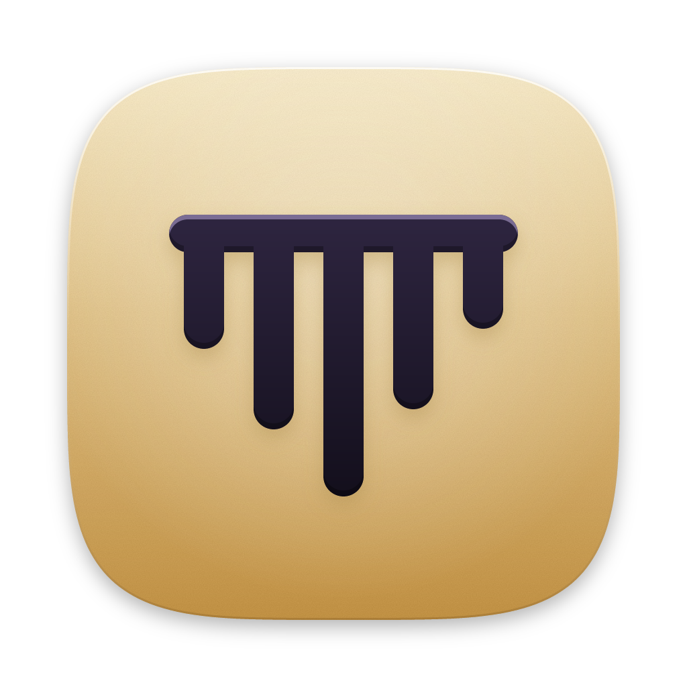

<p align="center">
  
</p>

<h1 align="center">Shabdly</h1>

<p align="center"><strong>Words that learn you.</strong></p>

<p align="center">
  Free, private voice dictation for macOS and Windows.<br>
  Speak English, Hindi, or Hinglish. Clean text appears in any app.
</p>

<p align="center">
  <a href="https://github.com/Karthik-Kumar02/shabdly/releases/latest"></a>
  <a href="https://github.com/Karthik-Kumar02/shabdly/releases/latest"></a>
</p>

<p align="center">
  <a href="https://github.com/Karthik-Kumar02/shabdly/actions/workflows/ci.yml"></a>
  <a href="LICENSE"></a>
</p>

---

## How it works

1. **Hold your dictation key** (Fn on Mac, Ctrl+Win on Windows) and talk.
2. **Let go.** Shabdly turns your speech into clean, punctuated text and types it where your cursor is: email, chat, docs, anywhere.
3. **Fix a word once.** Shabdly notices your correction and gets it right next time.

Everything runs on your own computer by default. No account, no subscription, no server.

## Features

**A dictionary that learns you**
- Correct a word after dictating ("Kartik" to "Karthik"), press Return, and Shabdly learns it. A small "Learned" note appears with an Undo button.
- Common words need the same fix twice before Shabdly swaps them, so "their" never quietly turns into "there".
- Add words yourself, star the important ones, and import or export your dictionary as JSON.
- Shortcuts: say "addr" and get your full address (any word can expand to any text).

**Hindi, English, and Hinglish together**
- **Auto** (default): English stays English, and any Hindi is written in Roman script, the way you would text it: "main kal aaunga".
- **Hinglish**, **Hindi** (Devanagari), and **English** modes when you want one fixed style.
- Filler words ("um", "uh") are removed, and self-corrections are applied: "5, no wait, 6" becomes "6".
- English words stay English. Shabdly never translates.

**Private by default**
- Speech recognition (Whisper) and cleanup (a local model through Ollama) both run on your computer.
- Prefer the cloud? Switch to Gemini (free tier or paid) or Claude Haiku in Settings.
- If cleanup is slow or unavailable, Shabdly still types your words and tells you "Cleanup skipped". Nothing is lost.

**Made for real work**
- Hold to talk, or double-tap the key to keep recording hands-free until you tap again. Esc cancels.
- A small pill at the bottom of the screen shows your mic level. It never takes focus from the app you are typing in.
- Password fields are never typed into. The text is copied instead, so you can paste it yourself.
- Your clipboard is put back after every dictation. On Mac that includes images, files, and formatted text; on Windows, text and images.
- History keeps your last 100 dictations (text only) so you can copy, re-insert, or fix a word later.

## Install

### Mac (Apple Silicon: M1 or newer)

1. Download the `.dmg` from the [latest release](https://github.com/Karthik-Kumar02/shabdly/releases/latest).
2. Open it and drag **Shabdly** into **Applications**.
3. Open Shabdly. The first time, macOS says it cannot check the app, because Shabdly is not yet signed with a paid Apple certificate. To allow it once:
   - Open **System Settings, Privacy & Security**, scroll down, and click **Open Anyway** next to Shabdly.
   - Or, in Terminal: `xattr -dr com.apple.quarantine /Applications/Shabdly.app`
4. Install [Ollama](https://ollama.com/download) for private, free cleanup. (Optional if you choose a cloud engine instead.)

On an Intel Mac, [build from source](#build-from-source).

### Windows 10 or 11

1. Download the `-setup.exe` from the [latest release](https://github.com/Karthik-Kumar02/shabdly/releases/latest) and run it.
2. If Windows SmartScreen appears, click **More info**, then **Run anyway**. (Shabdly is not yet signed with a paid certificate.)
3. Install [Ollama](https://ollama.com/download) for private, free cleanup. (Optional if you choose a cloud engine instead.)

Windows support is new and has been tested by the automated build, not yet by hand on many machines. Please [report anything odd](https://github.com/Karthik-Kumar02/shabdly/issues).

## First run

Shabdly walks you through setup in a few minutes:

1. **Welcome.** What Shabdly does, and that it stays on your computer.
2. **Microphone.** Allow access. Shabdly listens only while you hold your key.
3. **Typing into other apps** (Mac only). Turn Shabdly on under **Accessibility** (so it can type) and **Input Monitoring** (so it can see your key).
4. **Cleanup engine.** Shabdly finds Ollama and downloads its model, `gemma4:e4b` (about 10 GB, one time). No Ollama? Pick Gemini or Claude Haiku and paste your API key.
5. **Speech model.** A one-time download of about 0.9 GB.
6. **Try it.** Pick your key and language, then hold the key and say hello.

## Using Shabdly

| To do this | Do this |
| --- | --- |
| Dictate | Hold the dictation key, speak, let go |
| Dictate hands-free | Double-tap the key, speak, tap once to finish |
| Cancel | Press Esc while recording |
| Teach a word | Fix it right after dictating, then press Return |
| Open settings | Click the Shabdly icon in the menu bar or tray, or press Cmd+, on Mac |

Recordings shorter than 0.3 seconds are ignored, and recording stops on its own after 6 minutes.

### Cleanup engines

| Engine | Cost | Privacy | Notes |
| --- | --- | --- | --- |
| Local (Ollama) | Free | Never leaves your computer | Default. Needs about 10 GB of disk and a reasonably modern computer. |
| Gemini free tier | Free | Transcript and dictionary words sent to Google | Can be slow or skip cleanup when busy. |
| Gemini paid | Pay per use | Same as above | Faster and more reliable. |
| Claude Haiku | Pay per use | Transcript and dictionary words sent to Anthropic | Fast and accurate. |

## Privacy

- With the default engine, nothing you say or type leaves your computer.
- Audio is never saved. History keeps text only, and you can clear it or turn it off in Settings.
- Cloud engines receive only your transcript and your dictionary words. Never screenshots, never what is on your screen, never app names. Your saved shortcuts (like your address) are expanded on your computer after cleanup, so they are never sent.
- API keys are stored in your system's secure keychain (Keychain on Mac, Credential Manager on Windows), never in files or logs.
- Your dictionary, history, and settings live in your user folder as plain JSON files you can read, back up, or delete.

## Troubleshooting

**Nothing happens when I hold the key.**
On Mac, open **System Settings, Privacy & Security, Input Monitoring** and make sure Shabdly is on. Then quit and reopen Shabdly. You can also pick a different key in Settings.

**Pressing Fn opens the emoji picker or switches my keyboard.**
macOS uses the Fn (Globe) key too. In **System Settings, Keyboard**, set **Press Globe key to** to **Do Nothing**. Shabdly shows this tip when it detects the clash.

**The text is copied but not typed in.**
On Mac, turn Shabdly on under **System Settings, Privacy & Security, Accessibility**. If you were in a password field, that is on purpose: paste it yourself.

**It says "Shabdly can't hear your microphone".**
Allow the microphone under **System Settings, Privacy & Security, Microphone** (Mac) or **Settings, Privacy, Microphone** (Windows).

**It says "Cleanup skipped".**
The cleanup engine did not answer in time, so Shabdly typed your words without cleanup. Check that Ollama is running, or that your cloud API key is saved in Settings.

**It did not learn my correction.**
Shabdly learns when you fix a word in the same text box right after dictating, then press Return, click into another box, or wait a minute. Changes of more than 4 words are skipped, common words need the same fix twice, and a few apps (like Terminal) do not let Shabdly read their text.

## Build from source

You need [Rust](https://rustup.rs), [Node.js](https://nodejs.org) 20 or newer, and [CMake](https://cmake.org). On Windows you also need the Visual Studio C++ build tools (and LLVM, if the build asks for libclang).

```bash
git clone https://github.com/Karthik-Kumar02/shabdly.git
cd shabdly
npm install
npm run tauri build
```

The finished app is in `target/release/bundle/`. For development with live reload, run `npm run tauri dev`.

Run the tests with `cargo test --workspace`. With Ollama running, `cargo test -p shabdly-core --test spike_cases -- --ignored` checks the cleanup engine against real English, Hindi, and Hinglish samples.

## How it is built

- `crates/core`: the heart of Shabdly. Dictionary, learning, the cleanup pipeline, and speech recognition, with no operating-system code, so it can later power iOS and Android apps too.
- `src-tauri`: the desktop app, built with [Tauri 2](https://tauri.app). Hotkey, overlay, typing into other apps, settings.
- `src`: the interface, plain TypeScript and CSS.

See [CONTRIBUTING.md](CONTRIBUTING.md) to help out.

An open-source alternative to Wispr Flow.

## License

MIT. See [LICENSE](LICENSE).
